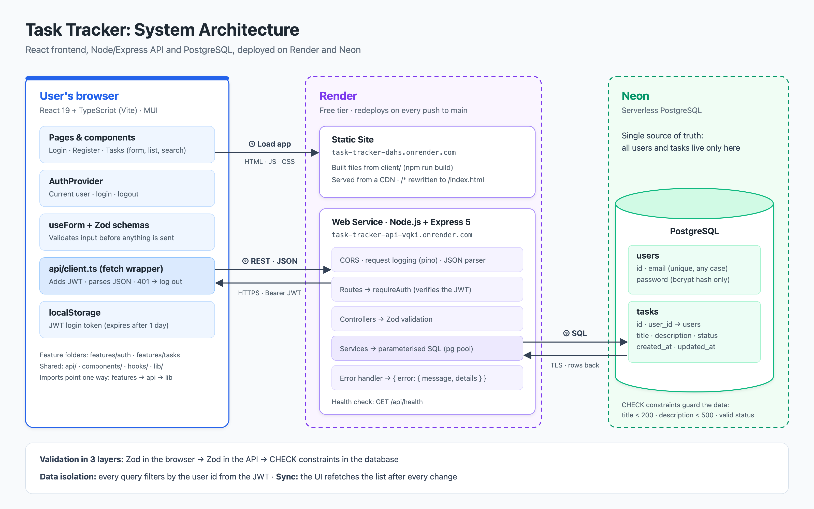

# Task Tracker

A small full-stack task tracker: sign up, then create, edit, filter and complete your tasks.

## Live demo

- **App:** https://task-tracker-dahs.onrender.com (register any email to try it)
- **API health check:** https://task-tracker-api-vqki.onrender.com/api/health

Hosted on Render's free tier: the API sleeps after 15 minutes without traffic, so the first request can take up to a minute. If the app says it can't reach the server, wait a moment and click **Retry**.

| Part     | Tech                                        | Folder               |
| -------- | ------------------------------------------- | -------------------- |
| Frontend | React + TypeScript (Vite), MUI              | `client/`            |
| Backend  | Node.js + Express + TypeScript              | `server/`            |
| Database | PostgreSQL (Neon) with plain SQL migrations | `server/migrations/` |

## Architecture



The browser loads the built React app from a static site, then talks to the API with JSON over HTTPS, sending the login token on each request. The API checks the token, validates input and runs parameterised SQL against PostgreSQL, which is the only place data is stored. After every change the UI fetches the list again, so it always matches the database. The diagram's source is [`docs/architecture.svg`](docs/architecture.svg).

## Run locally

You need Node.js 20+ and a PostgreSQL database. Use two terminals:

```bash
# 1. API: http://localhost:4000
cd server
npm install
cp .env.example .env      # set DATABASE_URL and JWT_SECRET
npm run migrate
npm run dev

# 2. Frontend: http://localhost:5173
cd client
npm install
cp .env.example .env
npm run dev
```

Then open http://localhost:5173 and create an account.

More detail: [`server/README.md`](server/README.md) (API, error format, logging) and [`client/README.md`](client/README.md) (structure, validation).

## Tests and code quality

```bash
cd server && npm test
cd client && npm test
```

Both projects also have `npm run lint` (ESLint), `npm run format` (Prettier, shared config in `.prettierrc.json`), `npm run typecheck` and `npm run test:coverage`.

## Deployment (Render)

Both parts deploy from this repo and redeploy on every push to `main`. The database is PostgreSQL on Neon.

| Setting         | API (Web Service)                                                                     | Frontend (Static Site)                               |
| --------------- | ------------------------------------------------------------------------------------- | ---------------------------------------------------- |
| Root directory  | `server`                                                                              | `client`                                             |
| Build command   | `npm ci --include=dev && npm run build`                                               | `npm ci && npm run build`                            |
| Start / publish | `npm start`                                                                           | Publish directory `dist`                             |
| Environment     | `NODE_ENV=production`, `DATABASE_URL`, `JWT_SECRET`, `CORS_ORIGIN` (the frontend URL) | `VITE_API_URL` (the API URL ending in `/api`)        |
| Other           | Health check path `/api/health`                                                       | Rewrite `/*` to `/index.html` so page refreshes work |

`--include=dev` is needed because TypeScript is a dev dependency. `VITE_API_URL` is read at build time, so changing it needs a redeploy of the static site.
